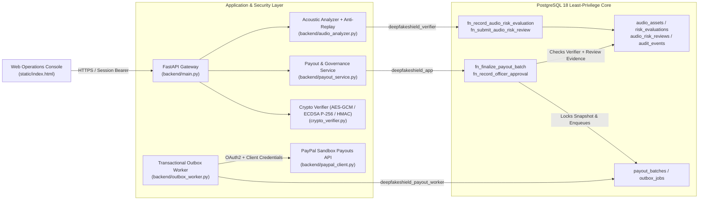
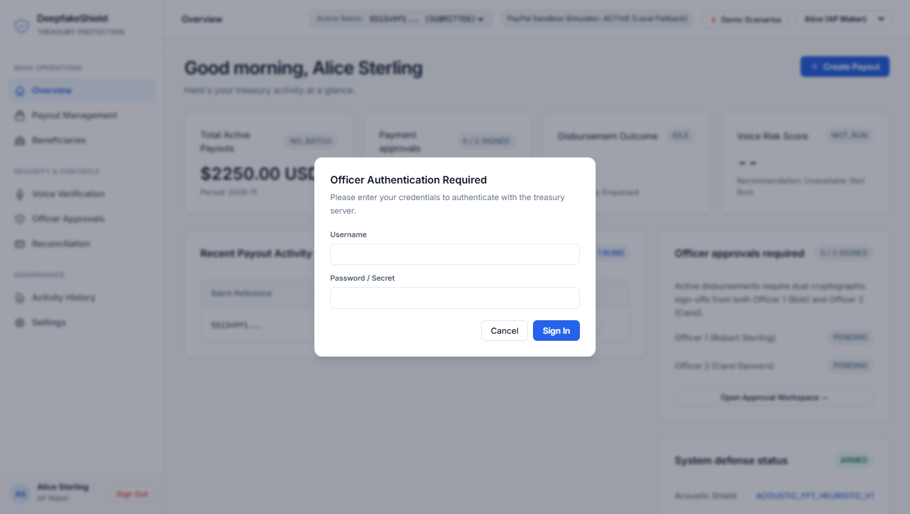
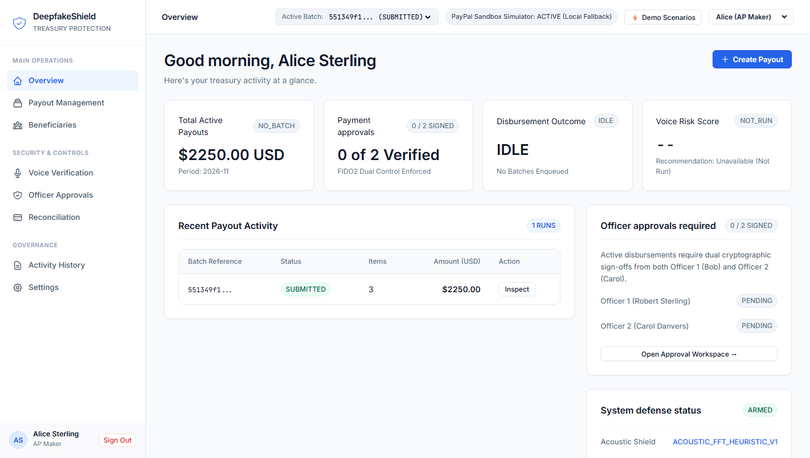
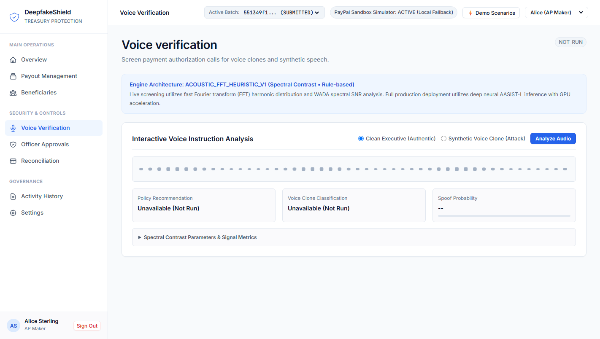
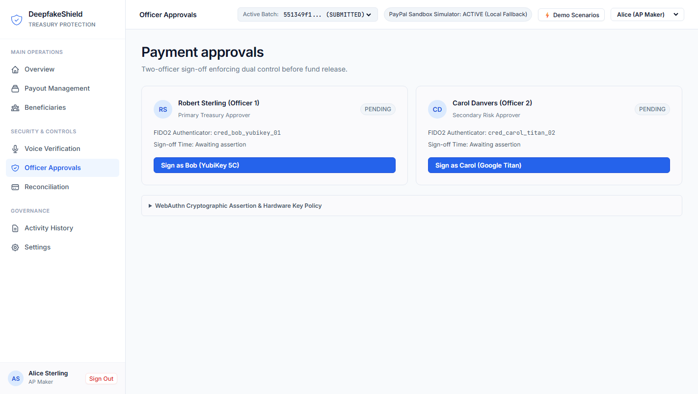
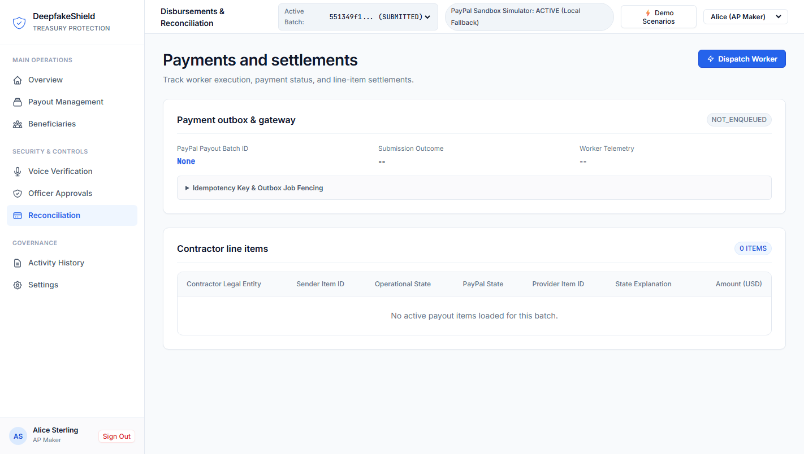
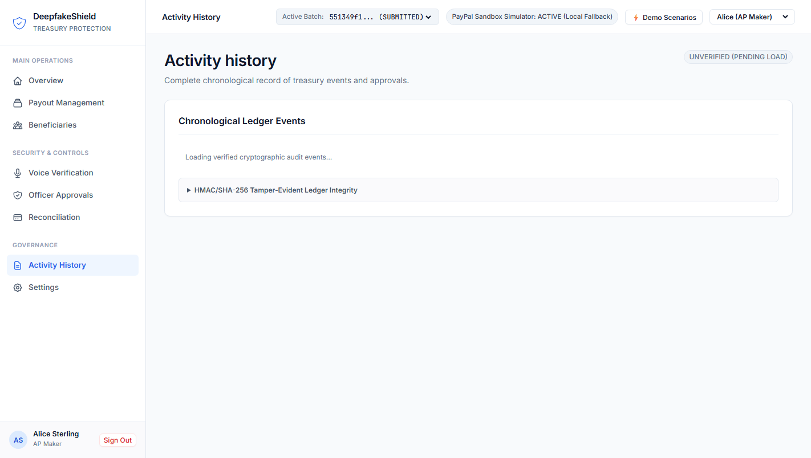

# DeepfakeShield for PayPal (V10.1.5)

**Voice-Authorized Disbursement Control & Fail-Closed Treasury Security Gate for PayPal Payouts**

> **Status Disclosure:** DeepfakeShield is an engineering prototype and reference security architecture built for controlled sandbox evaluation. It is **not production-ready** and uses a deterministic heuristic audio analyzer (`ACOUSTIC_FFT_HEURISTIC_V1`) rather than a trained neural deepfake detector. See [Truthful Capability Disclosure](#truthful-capability-disclosure) below before deploying or evaluating.

---

## Product Overview

**DeepfakeShield** is a defense-in-depth treasury control plane designed to protect outbound corporate payouts executed via the PayPal Payouts API (`SANDBOX_API` or `SIMULATOR`). When voice instructions or callback authorizations trigger or accompany batch disbursements, DeepfakeShield binds **audio verification**, **dual-officer cryptographic approvals**, **database-enforced state machines**, **encrypted payout snapshots**, and **idempotent transactional outbox delivery** into a fail-closed release pipeline.

---

## Problem Being Solved

Modern corporate treasury and Accounts Payable (AP) workflows face two intersecting failure modes:

1. **Voice-Cloned Authorization Fraud & Replay Attacks:** Attackers spoof executive callback approvals using AI voice cloning or replay previously recorded genuine audio snippets across different payment batches.
2. **Application-Layer Security Bypass:** When payment gates live only in web middleware, compromised application credentials, race conditions, or direct SQL writes can finalize batches, alter beneficiary recipients after approval, or double-submit outbound payouts.

DeepfakeShield enforces **fail-closed defense inside PostgreSQL itself**: unverified, replayed, stale, rejected, or tampered audio authorizations block batch finalization inside `SECURITY DEFINER` database functions regardless of application-tier state.

---

## Target Users

- **Corporate Treasury Teams:** Require dual-control cryptographic sign-off (`TREASURY_OFFICER`), hardware-style FIDO2/WebAuthn assertion verification, beneficiary integrity guarantees, and idempotent disbursement reconciliation.
- **Accounts Payable (AP) Teams:** Prepare draft payout batches (`AP_CLERK`), submit voice authorization recordings, monitor batch readiness, and avoid accidental double-payouts.
- **Risk Reviewers & Internal Auditors:**
  - `RISK_REVIEWER`: Independently inspects flagged (`CHALLENGE` / `NEEDS_REVIEW`) audio captures with full acoustic telemetry and records permanent `APPROVE_WITH_REVIEW` or `REJECT` dispositions.
  - `AUDITOR`: Inspects tamper-evident HMAC/SHA-256 chained `audit_events` logs with strictly read-only database permissions (`deepfakeshield_auditor`).

---

## System Architecture



### PostgreSQL Role Separation

| Database Role | Intended Responsibility | Enforced Boundary |
|---|---|---|
| `deepfakeshield_app` | Draft batch CRUD, finalization requests, officer approval submission | Denied direct `INSERT`/`UPDATE`/`DELETE` on `audio_assets`, `audio_consents`, `speaker_segments`, `risk_evaluations`, and `audio_risk_reviews`. |
| `deepfakeshield_verifier` | Executes `fn_record_audio_risk_evaluation()` and `fn_submit_audio_risk_review()` | Isolated role for committing audio risk decisions and manual risk review records. |
| `deepfakeshield_payout_worker` | Leases `outbox_jobs` (`FOR UPDATE SKIP LOCKED`) and records provider outcomes | Requires authoritative provider batch ID or failure evidence to transition submitted jobs. |
| `deepfakeshield_auditor` | Reads operational and audit ledger views | Strictly read-only; mutation permissions revoked. |

---

## Technology Stack

- **Backend API & Worker:** Python 3.11+, FastAPI, Pydantic, Uvicorn, Requests
- **Database & Security Enforcement:** PostgreSQL 18.x (`pgcrypto`, `SECURITY DEFINER` routines, row-level locking, append-only audit & review triggers)
- **Cryptography:** `cryptography` (AES-256-GCM payload snapshot sealing, ECDSA P-256 WebAuthn assertion verification, HMAC-SHA256 blind indexing & audit attestation) + RFC 7914 `scrypt` password hashing
- **Signal Processing:** `numpy`, `scipy` (16 kHz Mono PCM16 WAV parsing, FFT spectral flatness / Wiener entropy, high-frequency energy ratio, WADA SNR, SHA-256 + spectral fingerprint replay detection)
- **Frontend:** Vanilla HTML/CSS/JavaScript Operations Console (`static/index.html`)
- **Payment Provider Integration:** PayPal REST API v1 (`/v1/oauth2/token`, `/v1/payments/payouts`) with thread-safe OAuth token caching and local `SIMULATOR` fallback for deterministic fault-injection tests

---

## Core Features

- **Audio Anti-Replay Protection:** Atomic file-locked registry (`audio_hash_registry.json`) checking both exact file `SHA-256` and spectral acoustic fingerprints across batches/sessions.
- **Database Fail-Closed Audio Finalization Gate (`V10.1.4`):** `fn_finalize_payout_batch()` validates active 1:1 session isolation, explicit consent (`audio_consents`), latest `audio_assets`, evaluated `risk_evaluations` (`<= 1 hour` TTL, matching `batch_id`), and `AUDIO_RISK_EVALUATED` audit linkage directly inside PostgreSQL before emitting any encrypted snapshot or `outbox_jobs` entry.
- **Governed Manual Audio-Risk Review Workflow (`V10.1.5`):** Independent `RISK_REVIEWER` permission inspects original audio bytes, hashes, FFT metrics, and recipient context, then persists an append-only `APPROVE_WITH_REVIEW` or `REJECT` record via `fn_submit_audio_risk_review()` without ever overwriting or relabeling the original `CHALLENGE` / `NEEDS_REVIEW` evaluation.
- **Cryptographic Envelope & Blind Indexing:** Encrypted payout snapshots (`AES-256-GCM`) bound via SHA-256 plaintext/ciphertext digests and HMAC attestation keys, paired with HMAC-SHA256 beneficiary recipient blind indexing.
- **Dual-Officer WebAuthn Approvals:** Enforces distinct active `TREASURY_OFFICER` sign-offs (`bob_checker`, `carol_checker_two`) with monotonic WebAuthn signature counter checks before releasing outbox execution.
- **Crash-Resilient Outbox Worker & PayPal Client:** `FOR UPDATE SKIP LOCKED` job claiming, idempotent `sender_batch_id` scoping, and PayPal Sandbox OAuth2 Client Credentials + token caching.

---

## Truthful Capability Disclosure

Every component in this repository falls into one of the three honest engineering classifications below:

### `VERIFIED`
- **PayPal Sandbox OAuth:** Live OAuth 2.0 `client_credentials` token exchange against `https://api-m.sandbox.paypal.com/v1/oauth2/token` verified.
- **Payouts OAuth Permission:** Sandbox app token scope authorization for PayPal Payouts confirmed.
- **Token Caching:** Thread-safe shared OAuth token reuse scoped by `(base_url, sha256(client_id:client_secret))` verified via both live second-check reuse and isolated automated tests.
- **PostgreSQL V10.1.4 Database Protection:** Isolated migration rollout and integration verification confirmed `deepfakeshield_app` cannot directly tamper with protected audio tables, `deepfakeshield_verifier` writes exclusively through `fn_record_audio_risk_evaluation()`, and `fn_finalize_payout_batch()` rejects `CHALLENGE`, `NEEDS_REVIEW`, missing, and stale evidence with zero snapshots or outbox jobs created.
- **Replay Detection:** Exact `SHA-256` and acoustic spectral fingerprint deduplication across distinct batches/sessions verified against repeat uploads and fresh microphone captures.

### `IMPLEMENTED BUT NOT END-TO-END VERIFIED`
- **Two-Officer Approval Workflow:** Implemented across database (`V10_1_3`+) and FastAPI (`/api/batches/{batch_id}/webauthn/challenge`, `/approve`) and covered by automated/simulated integration tests, but **not yet executed end-to-end on a live draft payout batch through settlement**.
- **Actual PayPal Payout Submission and Reconciliation:** Live `/v1/payments/payouts` client, idempotency mapping, and `OutboxWorker` state transitions are implemented and tested against mocks/simulator, but **no live Sandbox dollar disbursement has been submitted end-to-end** in the current environment because microphone audio samples paused at the human review gate (`NEEDS_REVIEW`).
- **Manual Audio-Risk Review Workflow (`V10.1.5`):** Migration `V10_1_5__manual_audio_risk_review.sql`, API endpoints (`/api/batches/{batch_id}/audio-review`), UI controls, and `7/7` targeted unit/integration tests pass against a disposable PostgreSQL database (`test_07` in the legacy V10.1.4 suite expects the older pre-V10.1.5 direct-review block), **not yet applied to the live persistent DB or exercised live end-to-end with PayPal Sandbox payout release**.

### `LIMITED`
- **Acoustic Heuristic Engine:** Audio analysis currently uses `ACOUSTIC_FFT_HEURISTIC_V1` (rule-based FFT spectral flatness, high-frequency ratio `> 3500 Hz`, and WADA SNR estimation).
- **No Trained AASIST Checkpoint:** A genuine trained neural `AASIST` model checkpoint is **not installed** (`CHECKPOINT_HASH = None`). References to `WINDOW_SIZE = 64600` prepare compatible framing, not neural inference.
- **Human Microphone Samples Flagged `NEEDS_REVIEW`:** Real human microphone captures tested under the heuristic threshold produced `NEEDS_REVIEW` / `CHALLENGE`, requiring V10.1.5 governed human review rather than automated pass-through.

> **Production Readiness Notice:** This project is **not production-ready**. Do not point it at live/production PayPal credentials or real funds.

---

## Feature Matrix

| Capability | Classification | Evidence / Scope |
|---|---|---|
| PayPal Sandbox OAuth2 & Token Caching | **VERIFIED** | Live Sandbox token request + concurrency/isolation test suite (`backend/paypal_client.py`) |
| PayPal Payouts OAuth Scope Check | **VERIFIED** | Confirmed against Sandbox app token telemetry |
| Audio Replay Defense (`SHA-256` + Spectral FP) | **VERIFIED** | Verified on repeated uploads & microphone captures (`backend/audio_analyzer.py`) |
| PostgreSQL `V10.1.4` Fail-Closed Audio Gate | **VERIFIED** | Pre-migration rollout test + `test_database_audio_gate_migration.py` (6/6 passed) |
| Manual Audio-Risk Review (`V10.1.5`) | **IMPLEMENTED BUT NOT END-TO-END VERIFIED** | Disposable DB test suite (`test_v10_1_5_manual_audio_review.py`: 7/7 passed); pending live rollout |
| Dual-Officer FIDO2/WebAuthn Approval Flow | **IMPLEMENTED BUT NOT END-TO-END VERIFIED** | Tested with deterministic P-256 test keys (`tests/test_final_acceptance.py`); hardware keys not plugged in live |
| Live PayPal Sandbox Payout Submission & Recon | **IMPLEMENTED BUT NOT END-TO-END VERIFIED** | Mocked/simulator worker tests passed; zero live Sandbox payouts submitted |
| Deepfake Detection Model (`ACOUSTIC_FFT_HEURISTIC_V1`) | **LIMITED** | Heuristic signal scoring only; **no trained AASIST weights**; human mic samples scored `NEEDS_REVIEW` |

---

## Screenshots

| Login Gate | Treasury Overview Console |
|---|---|
|  |  |

| Voice Verification Screen | Dual-Officer Approvals |
|---|---|
|  |  |

| Reconciliation & Outbox Status | Activity Ledger & Settings |
|---|---|
|  |  |

*(Additional responsive and state screenshots are available under `screenshots/`.)*

---

## Installation Instructions

### Prerequisites

- **Python 3.11+**
- **PostgreSQL 18.x** (or PostgreSQL 16+ supporting `pgcrypto`, `SECURITY DEFINER`, and standard SQL procedural blocks; tested on PostgreSQL 18.6)
- Optional: A **PayPal Developer Sandbox** Business App (`Client ID` and `Client Secret` with Payouts enabled) for `SANDBOX_API` connectivity checks

### 1. Clone & Create Virtual Environment

```bash
git clone https://github.com/jayp91131-sudo/DeepfakeShield.git
cd DeepfakeShield
python -m venv .venv
```

Activate the virtual environment:

- **Linux / macOS:** `source .venv/bin/activate`
- **Windows (PowerShell):** `.venv\Scripts\Activate.ps1`

### 2. Install Python Dependencies

```bash
pip install --upgrade pip
pip install -r requirements.txt
```

---

## Environment Setup

Copy the template environment file and populate strong secrets **only in your local `.env`** (which is excluded by `.gitignore` and must never be committed):

```bash
cp .env.example .env
```

Key settings in `.env`:

1. **Runtime Security Policy (`DEMO_MODE=false` & `STRICT_CRYPTO_ENFORCEMENT=true` by default):**
   - By default (`DEMO_MODE=false`), normal application startup fails closed unless all required database role passwords, operator authentication credentials, and KMS cryptographic signing keys are explicitly supplied via environment variables. No fallback passwords, pre-seeded bearer tokens, or ephemeral demo officer signing keys are active outside explicit `DEMO_MODE=true`.
   - `STRICT_CRYPTO_ENFORCEMENT` is enabled by default and cannot be disabled outside `DEMO_MODE=true`.
   - `DEMO_MODE=true` is strictly blocked at startup and inside `PayPalClient` whenever `PAYPAL_BASE_URL` targets a PayPal production endpoint (e.g., `api-m.paypal.com` / `api.paypal.com`).
2. **PostgreSQL Connection & Role Passwords:**
   - `PGHOST`, `PGPORT` (default `5432`, or `5433` if running a secondary local cluster), `PGDATABASE=deepfakeshield_db`, `PGUSER=postgres`, `PGPASSWORD`.
   - `APP_PASSWORD`, `VERIFIER_PASSWORD`, `WORKER_PASSWORD`, `AUDITOR_PASSWORD` — must match the `ALTER ROLE ... WITH PASSWORD ...` credentials provisioned in PostgreSQL.
3. **Cryptographic Signing Keys (`STRICT_CRYPTO_ENFORCEMENT=true`):**
   - Generate independent, high-entropy 32-byte hex keys (`64` hex characters) for `ATTESTATION_SECRET`, `BLIND_INDEX_KEY`, and `AUTH_ASSERTION_KEY` (all-zero, short, malformed, and repeated-byte keys are rejected at import/startup):
     ```bash
     python -c "import secrets; print(secrets.token_hex(32))"
     ```
   - Keep `internal_security_keys` in PostgreSQL synchronized with these KMS/env values when initializing custom keys.
4. **Operator Authentication & WebAuthn Signing Keys:**
   - Configure explicit credentials for `ALICE_PASSWORD`, `BOB_PASSWORD`, `CAROL_PASSWORD`, `DAVE_PASSWORD`, and optionally `EVE_PASSWORD` (or `*_PASSWORD_HASH` / `OPERATOR_CREDENTIALS` JSON).
   - In normal mode (`DEMO_MODE=false`), simulated approvals are disabled (`HTTP 403`), so officers sign real WebAuthn assertions verified against `webauthn_credentials.public_key_cose` (unless explicit PEM test keys are supplied via `BOB_SIGNING_PRIVATE_KEY_PEM` / `CAROL_SIGNING_PRIVATE_KEY_PEM`).
5. **Optional `RISK_REVIEWER` Provisioning (`V10.1.5`):**
   - Reviewer identities are never hardcoded in source files. Generate a `scrypt` password hash, provision a `users` row with `role = 'RISK_REVIEWER'`, and configure `RISK_REVIEWER_USERNAME` + `RISK_REVIEWER_PASSWORD_HASH` (or `RISK_REVIEWER_CREDENTIALS`).

---

## PayPal Sandbox Configuration

1. Log in to the [PayPal Developer Dashboard](https://developer.paypal.com/).
2. Create or select a **Sandbox Business App** under **Apps & Credentials**.
3. Enable the **Payouts** permission on the Sandbox app and copy its **Client ID** and **Client Secret**.
4. Configure `.env`:
   ```ini
   PAYPAL_PROVIDER_MODE=SANDBOX_API
   PAYPAL_BASE_URL=https://api-m.sandbox.paypal.com
   PAYPAL_CLIENT_ID=<YOUR_SANDBOX_CLIENT_ID>
   PAYPAL_CLIENT_SECRET=<YOUR_SANDBOX_CLIENT_SECRET>
   ```
5. To run completely offline without contacting PayPal, set `PAYPAL_PROVIDER_MODE=SIMULATOR`.

---

## Database Migration Instructions

All schema changes are SQL migrations under `migrations/`. Each forward migration validates the previous `schema_migrations` version.

### Fresh Initialization (Starting at V10.1.3 -> V10.1.5)

1. To initialize a **disposable test database** (never `deepfakeshield_db`), set explicit `PGPASSWORD`, `APP_PASSWORD`, `VERIFIER_PASSWORD`, `WORKER_PASSWORD`, `AUDITOR_PASSWORD`, and `DISPOSABLE_PGDATABASE` (must contain `test` or `disposable`), then pass `--confirm-drop`:
   ```bash
   DISPOSABLE_PGDATABASE=deepfakeshield_disposable_test python setup_disposable_db.py --confirm-drop
   ```
   *(For normal/production initialization of `deepfakeshield_db`, create the database and apply `migrations/V10_1_3__security_repair.sql` manually via `psql`, then run `ALTER ROLE` for `deepfakeshield_app`, `deepfakeshield_verifier`, `deepfakeshield_payout_worker`, and `deepfakeshield_auditor`.)*

2. Apply `V10.1.4` (database-level fail-closed audio finalization gate):
   ```bash
   psql -h "$PGHOST" -p "$PGPORT" -U "$PGUSER" -d "$PGDATABASE" -v ON_ERROR_STOP=1 -f migrations/V10_1_4__database_audio_finalization_gate.sql
   ```

3. Apply `V10.1.5` (governed manual audio-risk review workflow):
   ```bash
   psql -h "$PGHOST" -p "$PGPORT" -U "$PGUSER" -d "$PGDATABASE" -v ON_ERROR_STOP=1 -f migrations/V10_1_5__manual_audio_risk_review.sql
   ```

4. Verify migration state:
   ```sql
   SELECT version, applied_at FROM schema_migrations ORDER BY applied_at;
   ```

---

## Demo Instructions

> Demo fixture seeding (`seed_demo_data()`), fallback operator/database passwords, pre-seeded demo bearer tokens, and single-process ephemeral WebAuthn demo keys require explicit `DEMO_MODE=true` (and are blocked against PayPal production endpoints). Multi-process demo deployments (`WEB_CONCURRENCY > 1` or `DEMO_MULTI_PROCESS=true`) require explicit `BOB_SIGNING_PRIVATE_KEY_PEM` and `CAROL_SIGNING_PRIVATE_KEY_PEM` (or `OFFICER_SIGNING_KEYS_JSON`) and fail closed otherwise.

1. **Enable Local Sandbox Demo Mode in `.env`:**
   ```ini
   DEMO_MODE=true
   PAYPAL_PROVIDER_MODE=SIMULATOR
   PAYPAL_BASE_URL=https://api-m.sandbox.paypal.com
   STRICT_CRYPTO_ENFORCEMENT=true
   # Provide 64-hex secrets for ATTESTATION_SECRET, BLIND_INDEX_KEY, and AUTH_ASSERTION_KEY
   ```
2. **Start the FastAPI Application Server:**
   ```bash
   uvicorn backend.main:app --host 127.0.0.1 --port 8000
   ```
3. **Open the Console:** Navigate to `http://127.0.0.1:8000/`.
4. **Sign In & Explore Roles:**
   - Default demo operator credentials can be overridden in `.env` (`ALICE_PASSWORD`, `BOB_PASSWORD`, `CAROL_PASSWORD`, `DAVE_PASSWORD`, `EVE_PASSWORD`; see `backend/main.py` for non-production demo usernames).
   - **AP Maker (`alice_ap_maker`):** Create a draft payout batch, upload or capture a 16 kHz Mono PCM16 WAV voice sample (or record locally using `python record_fresh_voice.py` into gitignored `audio_samples/`), and attempt finalization.
   - **Risk Reviewer (`RISK_REVIEWER`):** If `ACOUSTIC_FFT_HEURISTIC_V1` returns `NEEDS_REVIEW`, authenticate as an explicitly provisioned `RISK_REVIEWER` account to inspect acoustic metrics, SHA-256/spectral fingerprints, and record `APPROVE_WITH_REVIEW` or `REJECT`.
   - **Treasury Officers (`bob_checker`, `carol_checker_two`):** Complete WebAuthn/P-256 dual-officer approvals on finalized batches and trigger `/api/outbox/process` in `SIMULATOR` or `SANDBOX_API` mode.
5. **Run the Automated Test Suite (Disposable Database Required):**
   ```bash
   pytest tests/test_release_security_startup.py tests/test_database_audio_gate_migration.py tests/test_v10_1_5_manual_audio_review.py tests/test_paypal_sandbox_api.py
   ```
   > **Warning:** Several integration test modules recreate/seed database fixtures; always run `pytest` against a dedicated disposable database, never a persistent environment containing data you want to keep.

---

## Limitations and Roadmap

### Current Limitations
- **Heuristic Voice Detector Only:** `ACOUSTIC_FFT_HEURISTIC_V1` is a synthetic/spectral baseline (`spectral_flatness`, `> 3500 Hz` energy ratio, WADA SNR) with no neural anti-spoofing checkpoint (`AASIST`), yielding high manual-review rates (`NEEDS_REVIEW`) on real human microphone captures.
- **No Hardware FIDO2 Device Flow Live:** WebAuthn P-256 signature verification is enforced cryptographically in backend + DB using single-process ephemeral `DEMO_MODE=true` keypairs or environment-supplied PEM keys rather than physical USB security keys in a browser ceremony.
- **Local File Replay Registry:** Anti-replay deduplication stores hashes in a local lock-guarded JSON file (`audio_hash_registry.json`) rather than a distributed store.
- **No End-to-End Live PayPal Dollar Payout Completed Yet:** Live Sandbox OAuth and schema gates are verified, while full manual-review -> dual-officer approval -> live Sandbox `/v1/payments/payouts` settlement remains to be completed cleanly end-to-end.

### Roadmap
1. Integrate a real trained **AASIST / RawNet2** anti-spoofing ONNX/PyTorch model with calibrated ROC thresholds alongside real-world human speech benchmarks.
2. Move replay-registry deduplication and cryptographic key custody (`ATTESTATION_SECRET`, `BLIND_INDEX_KEY`, `AUTH_ASSERTION_KEY`) into PostgreSQL/Redis and Cloud KMS / HSM.
3. Wire browser-native `navigator.credentials.get()` WebAuthn ceremonies for hardware YubiKey / Titan tokens.
4. Complete live end-to-end PayPal Sandbox disbursement and webhook/batch status polling reconciliation after V10.1.5 live migration.
